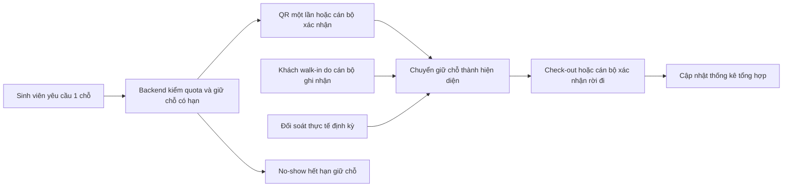
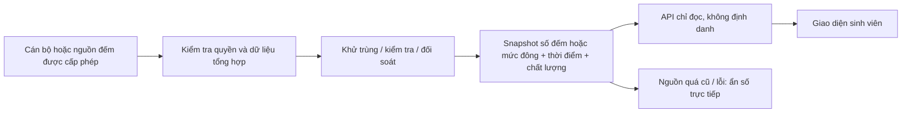

# Đề xuất pilot ULIS B2 — không phải hệ thống đã triển khai

Ngày lập: 13/11/2026. Phạm vi: Homies B2 và Nhà xe B2. Tất cả bước vận hành thật bên dưới cần phê duyệt của đơn vị quản lý, người phụ trách và kinh phí riêng. Bản thi hiện tại chỉ có frontend, JSON và mô phỏng trong trình duyệt; không có backend, tài khoản sinh viên, QR thật, thanh toán hay tích hợp thẻ.

## 1. Mục tiêu và điều kiện bắt đầu

Giảm việc sinh viên đến nơi nhưng thiếu thông tin về chỗ ngồi/gửi xe. Đo khả năng vận hành trước khi cam kết số chỗ trực tiếp.

Trước pilot thật, ULIS cần xác nhận: phạm vi sử dụng, sức chứa/quota được phép, giờ áp dụng, người trực, chính sách tiếp nhận sinh viên và cách thông báo tạm đóng. **98 ghế khảo sát không tự động trở thành quota 98 chỗ đặt**. Kho 3 chỗ của demo là dữ liệu giả lập, không được sao chép thành cấu hình vận hành. Giờ 06:45–20:00 hiện do chủ dự án quy định cho prototype, chưa phải phê duyệt lịch sự kiện/nhóm.

Đề xuất tiến độ sau phê duyệt: 2–3 ngày xác lập baseline/quy trình; 1 tuần thử ghi nhận thủ công; 1 tuần đánh giá và thử đặt chỗ giới hạn trong môi trường được cấp phép. Đây là kế hoạch tương lai, không phải cam kết xây backend trước 15/11.

## 2. Luồng Homies B2 đề xuất

Đặt chỗ và check-in là hai sự kiện khác nhau. QR một lần xác nhận quyền nhận chỗ, không thay thế quy trình kiểm thẻ sinh viên tại cửa. Cán bộ có thể check-in hộ khi QR không hoạt động. Walk-in phải được tính vào số người đang có mặt, kể cả không đặt chỗ.

### Quy tắc đếm và đặt chỗ

- `C`: sức chứa được quản lý phê duyệt; `B`: số chỗ tạm khoá; `P`: hiện diện được xác nhận (gồm walk-in); `R`: giữ chỗ chưa check-in; `Q`: quota đặt chỗ được phê duyệt.
- Chỗ tiếp nhận trực tiếp chỉ được suy ra từ `max(0, C - B - P)` khi số liệu còn đủ mới và đã đối soát. Quota đặt chỗ phải tính cả `R`, quota còn lại và chỗ vật lý; không hứa cùng một ghế cho walk-in và người giữ chỗ.
- Khi check-in, chuyển một giữ chỗ sang hiện diện trong **cùng một giao dịch**, không cộng cả hai. Khi kết thúc, trả chỗ sau xác nhận rời đi.
- Đặt chỗ thật cần ràng buộc giao dịch/unique cho lượt đang hoạt động, kiểm quota phía server, khoá phiên bản hoặc tương đương. Kiểm tra phía browser chỉ đủ cho demo, không chống đặt trùng giữa nhiều máy.
- Mọi sự kiện cần ID chống xử lý lặp, thời điểm phát sinh/nhận, phiên bản và trạng thái chấp nhận/từ chối. Thời gian lưu theo UTC; hiển thị giờ Việt Nam. Không suy ra thời gian check-in từ thời gian đặt chỗ.
- Nếu hiện diện/nguồn dữ liệu quá cũ, mâu thuẫn hoặc chưa đồng bộ, hiển thị “Chưa có dữ liệu chỗ trống trực tiếp”, không đưa số chỗ còn lại có vẻ chính xác.

### Các tình huống vận hành

| Tình huống | Xử lý đề xuất |
| --- | --- |
| Không đến nhận chỗ | Hết hạn giữ chỗ sau khoảng ân hạn được quản lý phê duyệt; demo hiện dùng 15 phút |
| Quên check-out | Đánh dấu cần đối soát; không tự khẳng định ghế vật lý đã trống chỉ vì hết giờ đặt |
| Rời đi mà chưa check-in | Hết hạn giữ chỗ/no-show; cán bộ đối soát nếu thực tế người đó đã vào nhưng bỏ bước check-in |
| Walk-in | Cán bộ ghi nhận hiện diện vào tổng đếm, áp dụng quota/check-in theo quy định, không tạo danh tính công khai |
| Tạm đóng/giảm chỗ | Cán bộ tạm dừng nhận đặt, khoá quota, thông báo lượt bị ảnh hưởng và ghi lý do nội bộ |
| Mất mạng/sự kiện trùng | Không xác nhận lượt mới nếu không kiểm được quota; sự kiện đánh ID, hàng chờ có giới hạn, khử trùng khi đồng bộ |
| Số đếm âm hoặc vượt sức chứa | Từ chối cập nhật không hợp lệ, đánh dấu cần đối soát, tạm ẩn số chỗ thay vì tự cắt số để che sai lệch |
| Điều chỉnh của cán bộ | Ghi bản sửa có thời điểm, vai trò thực hiện và lý do; giữ audit nội bộ, không đăng thông tin cá nhân |

**Giới hạn quan trọng:** demo tự hết hạn lượt check-in và giải phóng kho giả lập. Trong pilot thật, hết giờ đặt không chứng minh sinh viên đã rời ghế; phải xử lý hiện diện chưa xác nhận bằng đối soát/stale state.

## 3. Nhà xe B2 — hai giai đoạn

### Giai đoạn 1: nhập thủ công có thời điểm

Cán bộ ghi mức đông (`còn chỗ`, `đông`, `đầy`, `chưa rõ`) hoặc số đếm ước lượng nếu có phương pháp đáng tin. Mỗi bản cập nhật có thời điểm quan sát, thời điểm nhập, nguồn/phương pháp và nhãn “Ước lượng thủ công”. Đề xuất thử chu kỳ 15–30 phút lúc cao điểm nếu nhân sự cho phép; cần đo khối lượng công việc trước khi chốt. Khi quá hạn freshness được duyệt (ví dụ 15 phút cho thử nghiệm), ẩn số chỗ trực tiếp, chỉ giữ quan sát quá khứ có ngày giờ.

Không lấy 480–500 xe ngày 11/11 trừ khỏi khoảng 480 sức chứa để tính số chỗ. Khi không có sức chứa được phép và số đếm hiện tại đủ tin cậy, chỉ công bố mức đông được ghi nhận kèm thời điểm. Số khoảng 400 trong hướng dẫn thi là ghi chú lịch sử riêng.

### Giai đoạn 2: nghiên cứu tích hợp được cho phép

Trước hết xác định nhà cung cấp, chủ sở hữu dữ liệu, khả năng xuất **số tổng hợp**, quyền truy cập và giới hạn hợp đồng. Camera chụp biển số không có nghĩa có API hoặc có số xe hiện tại dùng được. Ưu tiên lấy các sự kiện/vận hành tổng hợp đã khử định danh; không đưa biển số hoặc mã thẻ lên website.

Nếu không thể tích hợp, cân nhắc bộ đếm hướng vào/ra độc lập tại cổng chung, sau khảo sát lắp đặt và cấp phép. Cổng dùng chung đòi hỏi kiểm thử xe đi sát nhau, quay đầu, hướng ngược, người đi bộ và đếm trùng; luôn cần baseline/đối soát. Không đề xuất nhận dạng biển số hay AI camera cho bản thi này.

## 4. Vai trò, quyền riêng tư và phụ thuộc

| Vai trò | Trách nhiệm |
| --- | --- |
| Quản lý ULIS/cơ sở | Phê duyệt pilot, sức chứa, giờ, quota, điều kiện vào và chính sách dữ liệu |
| Cán bộ giám sát Homies | Kiểm thẻ, xác nhận check-in/walk-in, đối soát, tạm đóng và xử lý sai lệch |
| Cán bộ nhà xe | Ghi mức đông/ước lượng, ngày giờ và phương pháp; xác nhận khả năng nguồn thẻ |
| Nhóm kỹ thuật | Backend được cấp phép trong tương lai, bảo mật, idempotency, monitor, backup và audit |
| Sinh viên | Dùng thông tin đã ghi thời điểm, tuân thủ điều kiện tiếp cận; thực hiện check-in/out theo pilot |

Frontend công khai chỉ đọc snapshot tổng hợp. Nếu đặt chỗ thật cần nhận diện người dùng để chống trùng, dùng cơ chế được ULIS cho phép, tối thiểu hoá mã định danh và tách khỏi API công khai. QR là token một lần, có hạn, không chứa tên/thẻ/biển số dạng đọc được. Cán bộ có phân quyền riêng; lịch sử điều chỉnh được bảo vệ. Quy định thời gian lưu và xoá dữ liệu cần được đơn vị quản lý phê duyệt; không mặc định lưu lâu dài. Không dùng ảnh, thẻ hay biển số từ khảo sát làm tài liệu demo.

Phụ thuộc chưa có: chấp thuận đơn vị, cán bộ vận hành, sức chứa chính thức/quota, mạng/thiết bị tại chỗ, backend an toàn và đăng nhập khi cần, thoả thuận nguồn dữ liệu, kiểm thử thiết bị nếu lắp bộ đếm. Tất cả là tương lai; không có dịch vụ nào được kết nối trong sprint này.

## 5. Nguồn lực và chi phí pilot sơ bộ

Các con số dưới đây là **giả định lập kế hoạch**, không phải báo giá, ngân sách đã duyệt hoặc chi phí đã chi. Ưu tiên tận dụng thiết bị và ca trực hiện có.

| Hạng mục | Nguồn lực giả định | Cách chốt chi phí |
| --- | --- | --- |
| Chuẩn hoá dữ liệu/quy trình B2 | 8–12 giờ nhóm dự án + người quản lý duyệt | Dùng nhân lực hiện có; giá giờ công do đơn vị xác định |
| Đào tạo/kiểm thử vận hành | 2 buổi, khoảng 2 giờ/buổi | Lịch cán bộ và chi phí thời gian phải được quản lý chấp thuận |
| Đối soát thủ công | Giả định 20–40 phút/ngày cho mỗi điểm ở giai đoạn thử; đo lại trong pilot | Không coi lao động là miễn phí; không hứa cập nhật liên tục nếu thiếu nhân lực |
| Biển hướng dẫn/QR minh hoạ | Dự trù 100.000–300.000 VND cho in ấn nhỏ | Chỉ là khoảng dự trù, cần báo giá và phê duyệt trước khi in |
| Điện thoại/tablet/mạng | Tận dụng thiết bị sẵn có nếu được phép | Chi phí tăng thêm có thể bằng 0 khi đủ tài nguyên; nếu cần mua, xin báo giá riêng |
| Hosting prototype | Dùng cấu hình hiện có nếu tài khoản đủ điều kiện/quota | Không mua gói, không cam kết miễn phí vô hạn; kiểm giới hạn thực tế |
| Backend/tích hợp/bộ đếm thật | Chưa triển khai; chi phí chưa biết | Khảo sát, quyền truy cập và báo giá riêng, ngoài deadline cuộc thi |

Không cộng chi phí phần cứng/tích hợp chưa biết thành tổng ngân sách giả. Trước khi mở rộng phải xác định người chịu vận hành và nguồn kinh phí duy trì, không chỉ chi phí lập trình.

## 6. Đánh giá, giới hạn và mở rộng

Đề xuất đo: tỷ lệ bản cập nhật đúng hạn; độ lệch so với đếm/đối soát thực tế; tỷ lệ no-show; số lỗi/đặt trùng bị chặn; thời gian cán bộ phải thao tác; số phản hồi sinh viên tìm được địa điểm và hiểu đúng nhãn “không trực tiếp”. Chưa có số đo pilot thật và không gán kết quả giả cho các chỉ số này.

Sau B2: chỉ thêm Homies C3/Đa năng khi khảo sát toạ độ, điều kiện, giờ, nguồn, quota và được đơn vị cho phép. C1T hoặc địa điểm học tập khác không tự trở thành Homies. Mở rộng Xuân Thủy theo adapter nguồn/role/campus, rồi mới nghiên cứu Hòa Lạc. Lưới 12 tiện ích thể hiện định hướng; 10 mục “Sắp ra mắt” không có chức năng hay cơ sở giả.

| Tiêu chí sơ bộ | Bằng chứng trình bày | Giới hạn cần nói rõ |
| --- | --- | --- |
| Thực tiễn — 30 | Luồng chọn tiện ích → bản đồ → điều kiện/giờ/chỉ đường; hai điểm B2 có khảo sát | Chưa có số chỗ trực tiếp, chưa đo lợi ích pilot |
| Đổi mới — 25 | Đặt chỗ + check-in/out + no-show, kết hợp vận hành thủ công và dữ liệu có thời điểm | Booking hiện là demo; không mô tả thuật toán/AI chưa có |
| Khả thi — 25 | Lộ trình thủ công trước, tích hợp sau; phân vai, đối soát, chi phí và quyền dữ liệu | Backend/hardware thật cần phê duyệt riêng |
| Tài liệu/kế hoạch — 20 | Provenance, test, ảnh, demo script, UAT và kế hoạch pilot này | Không tự chấm điểm hoặc khẳng định kết quả ban giám khảo |
